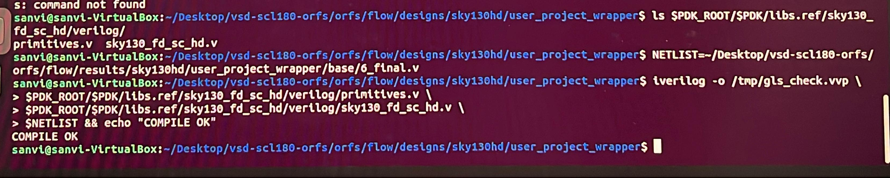

# Week 5 – Phase 1: Prepare Gate-Level Netlist

## Objective
Locate the Week-4 gate-level netlist of `user_project_wrapper`, confirm its dependencies are available, and verify it is simulation-ready.

## 1. Netlist Used

**Path:**
```
~/Desktop/vsd-scl180-orfs/orfs/flow/results/sky130hd/user_project_wrapper/base/6_final.v
```

| Property | Value |
|---|---|
| Flow | OpenROAD-flow-scripts (ORFS), platform `sky130hd` |
| Size | 70 KB |
| Standard-cell references | 658 (`sky130_fd_sc_hd__`) |

## 2. How the Correct Netlist Was Chosen

- The `base/` folder contains every stage output (`1_synth.odb` to `6_final.gds`), so the Week-4 flow completed.
- `1_2_yosys.v` is the post-synthesis netlist. It lacks the clock-tree buffers, repair cells and fill cells added later.
- `6_final.v` is written after placement, CTS, routing and fill, so it matches the final layout (`6_final.gds`).
- Header check: `module user_project_wrapper` with the Caravel ports (`wb_*`, `io_*`, `la_*`, `analog_io`, `user_irq`).
- `config.mk` confirms `PLATFORM = sky130hd` and a 3000 x 3000 µm die. The wrapper was built from RTL with no hardened macro inside, so one netlist file is enough.

```bash
head -30 6_final.v
grep -c "sky130_fd_sc_hd__" 6_final.v      # 658
cat ~/Desktop/vsd-scl180-orfs/orfs/flow/designs/sky130hd/user_project_wrapper/config.mk
```

## 3. Dependencies

The simulator needs a Verilog model for every standard cell in the netlist.

| File | Purpose |
|---|---|
| `primitives.v` | Basic building blocks used by the cell models |
| `sky130_fd_sc_hd.v` | Verilog models of all sky130 HD cells |

Found in the **sky130A** PDK (Caravel uses sky130A):

```bash
find / -name "sky130_fd_sc_hd.v" 2>/dev/null | head
export PDK_ROOT=~/Desktop/vsdsquadron-soc/.ciel/volare/sky130/versions/<hash>
export PDK=sky130A
ls $PDK_ROOT/$PDK/libs.ref/sky130_fd_sc_hd/verilog/
# primitives.v  sky130_fd_sc_hd.v
```

## 4. Simulation-Ready Check

```bash
NETLIST=~/Desktop/vsd-scl180-orfs/orfs/flow/results/sky130hd/user_project_wrapper/base/6_final.v

iverilog -o /tmp/gls_check.vvp \
  $PDK_ROOT/$PDK/libs.ref/sky130_fd_sc_hd/verilog/primitives.v \
  $PDK_ROOT/$PDK/libs.ref/sky130_fd_sc_hd/verilog/sky130_fd_sc_hd.v \
  $NETLIST && echo "COMPILE OK"
```

**Result:** `COMPILE OK` – no missing modules or syntax errors.



## Summary

| Item | Status |
|---|---|
| Netlist path identified | Done |
| Selection reasoning documented | Done |
| Dependencies available | Done |
| Netlist compiles with cell models | Done |
