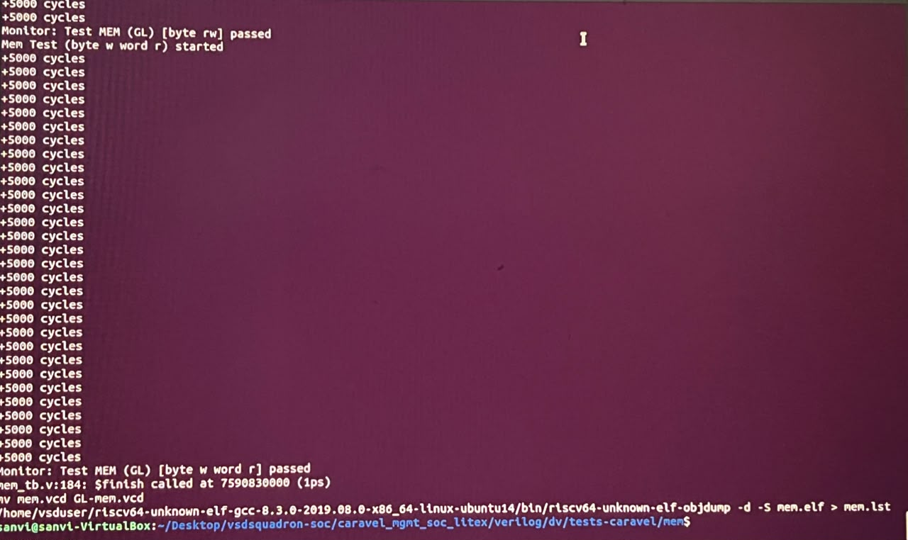

# Week 5 – Phase 2: Modify Verification Flow for GLS

## Objective
Extend the existing Week-3 verification flow so the testbench simulates the gate-level netlist (`6_final.v`) of `user_project_wrapper` instead of the RTL. No new flow was created.

## 1. Approach
The Week-3 test Makefile already has a gate-level branch, selected with `make SIM=GL` (default is `SIM=RTL`). In this branch the compiler runs with `-DGL -DSIM -DFUNCTIONAL -DUSE_POWER_PINS -DUNIT_DELAY=#1`, so the testbench switches to gate-level files. The Makefile was therefore **not edited**. The changes were made to the files this branch reads.

```makefile
ifeq ($(SIM),GL)
    iverilog -Ttyp -DFUNCTIONAL -DGL -DSIM -DUSE_POWER_PINS -DUNIT_DELAY=#1 \
      -f$(VERILOG_PATH)/includes/includes.gl.caravel \
      -o $@ $(CARAVEL_PATH)/gl/__user_project_wrapper.v $<
```


## 2. Changes Made

| # | Change | Reason |
|---|---|---|
| 1 | Copied `6_final.v` to `$(CARAVEL_PATH)/gl/__user_project_wrapper.v` | This is the file the GL branch compiles as the wrapper |
| 2 | Added the 8 power ports (`vdda1, vdda2, vssa1, vssa2, vccd1, vccd2, vssd1, vssd2`) to the module header and as `inout` | The testbench is built with `-DUSE_POWER_PINS` and connects these pins. The Week-4 netlist is functional and has none, which caused `port ... is not a port of mprj` errors |
| 3 | In `includes.gl.caravel`, replaced the full gate-level Caravel list with the RTL list (`includes.rtl.caravel`) and added the cell models `primitives.v` and `sky130_fd_sc_hd.v` | Only the wrapper should be gate-level, and the sky130 cell models are needed to simulate it |

Commands used:
```bash
# 1 + 2: netlist copy with power ports
W=/home/vsduser/caravel/verilog/gl/__user_project_wrapper.v
cp ~/Desktop/vsd-scl180-orfs/orfs/flow/results/sky130hd/user_project_wrapper/base/6_final.v $W
sed -i 's/^module user_project_wrapper (user_clock2,/module user_project_wrapper (vdda1, vdda2, vssa1, vssa2, vccd1, vccd2, vssd1, vssd2, user_clock2,/' $W
sed -i '0,/^\s*input user_clock2;/s//  inout vdda1, vdda2, vssa1, vssa2, vccd1, vccd2, vssd1, vssd2;\n  input user_clock2;/' $W

# 3: include list (original saved as includes.gl.caravel.full_gl)
P=$PDK_ROOT/$PDK/libs.ref/sky130_fd_sc_hd/verilog
grep -v "user_project_wrapper" includes.rtl.caravel > includes.gl.caravel
echo "-v $P/primitives.v"        >> includes.gl.caravel
echo "-v $P/sky130_fd_sc_hd.v"   >> includes.gl.caravel
```

## 3. Issues Faced and Resolution

| Issue | Cause | Resolution |
|---|---|---|
| `Unknown module type: caravel_core` and `sky130_ef_sc_hd__fill_4` | The full gate-level Caravel list was missing blocks and filler-cell models | Not patched further. The list was reduced to the wrapper-only gate-level setup (change 3) |
| `port ... is not a port of mprj` | Power pins missing in the functional netlist | Change 2 |
| Compile used all RAM and did not finish (VM had about 5 GB) | Full gate-level Caravel is over 1 million lines | Wrapper-only gate-level setup, plus a larger VM memory |

## 4. Result (test run: `mem`)

```bash
cd tests-caravel/mem
make clean
make SIM=GL
```

- `Monitor: Test MEM (GL) [byte rw] passed`
- `Monitor: Test MEM (GL) [byte w word r] passed`
- `$finish` called, and `GL-mem.vcd` was generated (used in Phase 5)



## Summary

| Item | Status |
|---|---|
| RTL replaced by `6_final.v` in the existing flow | Done |
| Dependencies included (cell models) | Done |
| No missing module or library errors | Done |
| Test run in GL mode | `mem` passed |

